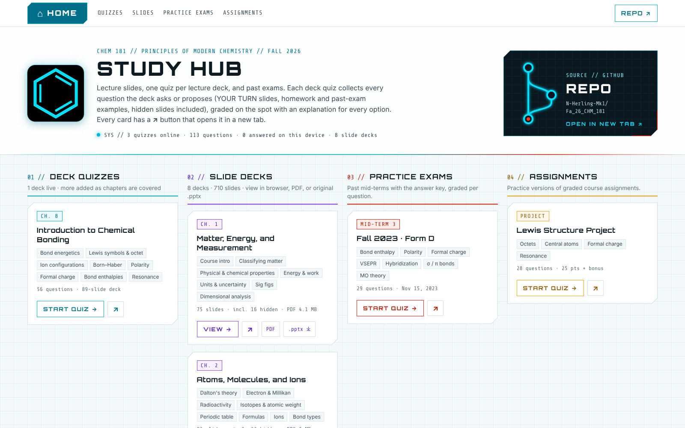

# CHEM 181 Study Hub

<p align="center">
  <a href="https://n-herling-mk1.github.io/Fa_26_CHM_181/" target="_blank" rel="noopener">
    
  </a>
</p>

<p align="center">
  <a href="https://n-herling-mk1.github.io/Fa_26_CHM_181/" target="_blank" rel="noopener"><b>▶ Open the live site ↗</b></a>
  &nbsp;·&nbsp; https://n-herling-mk1.github.io/Fa_26_CHM_181/
</p>

Static study site for CHEM 181 (General Chemistry I): a navigation page, the lecture slide decks, and one page per quiz. Plain HTML, CSS and JavaScript, no build step. It works when opened straight from disk (`file://`) or served with GitHub Pages.

## Layout

```
index.html                         hub: top nav + four columns (deck quizzes | slide decks | practice exams | assignments);
                                   edit DECKS / EXAMS / OTHERS here, slide decks in assets/js/slides.js
assets/img/                        tab icon: favicon-32.png, favicon.ico (16/32/48), apple-touch-icon.png, icon-512.png;
                                   site-preview.png (README screenshot)
assets/vendor/fonts/               Orbitron + Share Tech Mono (self-hosted, SIL OFL) for the hub's TRON Ares light style
assets/
  css/hub.css                      navigation page styles
  css/quiz.css                     quiz page styles (Brightspace-like layout)
  js/quiz-engine.js                shared quiz renderer, grader and explanation panel
  js/slides.js                     slide-deck list (SLIDE_DECKS), read by the hub and the slide viewer
  vendor/katex/                    KaTeX 0.16 + mhchem + auto-render, bundled for offline use (MIT)
slides/
  viewer.html                      slide viewer: viewer.html?d=ch06 shows that deck's PDF, with deck picker, Open PDF, .pptx download
  decks/                           181.N_Ch_N_2026.pptx (original) + .pdf (LibreOffice render, hidden slides included)
quizzes/
  quiz01-lewis-structures/
    index.html                     quiz page
    data.js                        questions, answer key, explanations for every option
    img/                           structure images cropped from the original quiz
  quiz02-ch08-chemical-bonding/
    index.html                     quiz page
    data.js                        56 questions (47 from the Ch. 8 lecture deck + 9 added), keys, explanations
    img/                           figures and option images cropped from the deck, plus reference tables
  quiz03-ch09-molecular-geometry/
    index.html                     quiz page
    data.js                        54 questions from the Ch. 9 lecture deck, keys, explanations
    img/                           figures and option images cropped from the deck
  exam03-mt3-f23/
    index.html                     practice exam page
    data.js                        Mid-term #3 (Fall 2023, form D): 29 questions with the key
    img/                           exam figures, the exam's information pages, redrawn MO diagram
```

## Quiz features

- Questions are drawn in the original format: checkboxes, radio buttons, drop-downs and typed numeric answers, with the original structure drawings.
- Deck quizzes tag each question with its source slide (hidden slides are marked) and can attach collapsible reference figures (periodic table, electronegativities, bond enthalpies).
- **Check** grades one question right away; **Grade all** grades everything. The top bar shows progress and the total score.
- The side panel (a drawer on narrow screens) lists every option with the key, your choice, ✓/✗, and why. **Peek** shows the key without grading.
- Multi-select questions use right-minus-wrong scoring per option, which reproduces the original quiz's partial scores (for example $(6-1)/7 = 0.714$).
- Answers persist in `localStorage` per quiz, and **Reset** clears them.

## Navigation

- Every page has a large **Home** button at the left of its top bar; the hub's top nav also jumps to each column.
- Every hub card has a **↗** button that opens it in a new tab (the card itself opens in the same tab). Slide cards add **PDF** (new tab) and **.pptx ⤓** (download).

## Adding a slide deck

1. Put `181.N_Ch_N_2026.pptx` in `slides/decks/` and export the PDF next to it with hidden slides included:
   `soffice --headless --convert-to 'pdf:impress_pdf_Export:{"ExportHiddenSlides":{"type":"boolean","value":"true"}}' --outdir slides/decks slides/decks/181.N_Ch_N_2026.pptx`
2. Append an entry to `SLIDE_DECKS` in `assets/js/slides.js` (`key`, `chapter`, `title`, `file` without extension, slide counts, file sizes, `topics`, and `quiz` if the chapter has one).

## Adding a quiz

1. Copy `quizzes/quiz01-lewis-structures/` to a new folder.
2. Rewrite `data.js`. Question types are `single`, `multi`, `match` and `numeric` (`answer`, optional `tol`, `unit`; accepts `1.5`, `3/2`, `1 1/2`). The field reference is at the top of `quizzes/quiz02-ch08-chemical-bonding/data.js`. Math goes in `$...$`, and chemical formulas in `\ce{...}`.
3. Give the quiz a unique `id`, then add an entry to `DECKS` (or `EXAMS`) in the root `index.html` with the same `id`, the question count as `total`, and its `href`. The card shows saved progress from that `id`.

## Hosting on GitHub Pages

Settings → Pages → Deploy from branch → `main` / root. The `.nojekyll` file makes Pages serve the files as they are.
